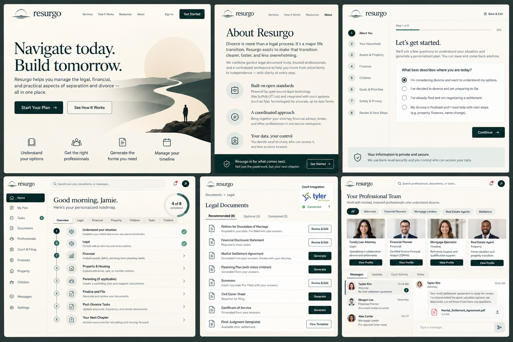

# Resurgo

`Navigate today. Build tomorrow.`

**Divorce is complicated. Finding your way shouldn't be.**

Resurgo is an open-source-first divorce transition coordination platform. Its purpose is to replace fragmented email chains with guided discovery, personalized case roadmaps, secure document exchange, and carefully scoped professional handoffs.

## Product boundaries
The platform coordinates legal, financial, housing, and personal-support workflows. It does not itself practice law, underwrite loans, or provide clinical care. Information exchange is explicit, purpose-limited, and auditable.

## MVP v0.1
Discovery to Documents: identity, case creation, guided intake, deterministic service recommendations, private PDF upload and preview, basic access controls, and audit events.

## Later milestones
- v0.2: document requests, comments, immutable version comparison, professional invitations and grants
- v0.3: coordinated scheduling and availability integration
- v0.4: durable cross-professional handoffs using Temporal
- v0.5: Docassemble/Suffolk Assembly Line and jurisdiction-specific document packages
- Later: authorized court filing adapters and regulated provider integrations

## Getting started
Read [AGENTS.md](AGENTS.md) and [docs/product-brief.md](docs/product-brief.md). This starter package contains planning files only; the implementation agent should scaffold the app and supply working setup commands.
