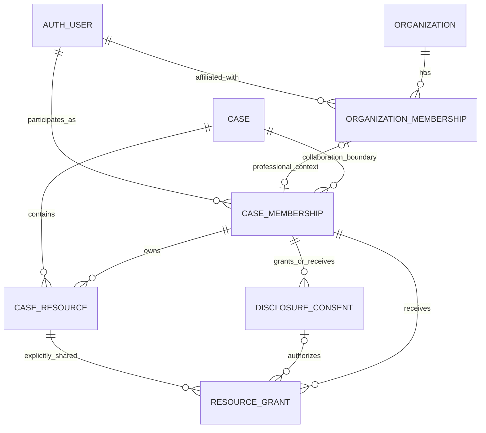

# v0.1 security-boundary data model

**Status:** Phase B1 implemented in migration `0001_dizzy_charles_xavier.sql`.
**Tickets:** RES-003, RES-010 through RES-016, RES-018 through RES-021, RES-040

## Ownership and authorization rules

- Better Auth owns `auth.user`, `auth.session`, `auth.account`, and
  `auth.verification`. The schema targets Better Auth 1.7.14's documented
  PostgreSQL/Drizzle contract; runtime adapter validation is a RES-006 gate.
- Organizations are professional affiliation and administration boundaries. They
  do not own cases and organization membership never grants case or resource
  access.
- A case is the primary coordination boundary. Creation transactionally adds an
  active `owner` membership. A deferred database invariant rejects a case without
  exactly one active owner relationship.
- Case membership permits case-level actions only. It never implies document
  access.
- A professional case membership references that user's organization membership,
  but no permission lookup can use the organization membership as a grant.
- Every protected resource operation requires a current, action-specific
  `resource_grant` addressed to one case membership. Grants are never addressed
  to an organization in v0.1.
- Consent and access are distinct. A disclosure authorization records the
  client's instruction and purpose; a grant is the technical permission. Policy
  may deny a grant even when consent exists because professional duties or legal
  restrictions take precedence.
- Legal, financial, and personal-support content uses an explicit classification
  and compartment. Cross-compartment status exchange is allowlisted and carries
  coordination metadata only.

## Implemented Phase B1 relations

The diagram does not contain an organization-to-case or organization-to-resource
edge. That absence is intentional.

| Relation                    | Important fields and constraints                                                                                                                                                                          |
| --------------------------- | --------------------------------------------------------------------------------------------------------------------------------------------------------------------------------------------------------- |
| `auth.user`                 | Better Auth core identity row; UUID primary key and unique email                                                                                                                                          |
| `auth.session`              | Better Auth core session row; unique token, expiry and user indexes                                                                                                                                       |
| `auth.account`              | Better Auth core authentication method; unique provider/account pair; password remains adapter-owned                                                                                                      |
| `auth.verification`         | Better Auth core expiring verification record                                                                                                                                                             |
| `organizations`             | Professional affiliation only; opaque ID, unique slug and explicit professional type                                                                                                                      |
| `organization_memberships`  | User-to-organization affiliation, role and lifecycle; never referenced by a resource grant                                                                                                                |
| `jurisdictions`             | Extensible court registry; only enabled configuration may be used; v0.1 seeds Fulton and DeKalb Superior Courts                                                                                           |
| `cases`                     | `id`, owner and creator references, configured `jurisdiction_code`, status and timestamps; no organization owner                                                                                          |
| `case_memberships`          | composite key `(case_id, user_id)`, role, status, valid interval; no global case role                                                                                                                     |
| `case_resources`            | Security envelope for later documents/intake/roadmap/notes; case, owner membership, type and classification only                                                                                          |
| `disclosure_consents`       | Case-specific grantor and recipient memberships, classification, operation, purpose, immutable terms hash and lifecycle                                                                                   |
| `resource_grants`           | Explicit case-member grant for one resource, classification and operation; consent scope is protected by a composite foreign key                                                                          |
| `audit_events`              | Actor, action, target, case, outcome, correlation/causation IDs and hash fields; database trigger rejects update/delete                                                                                   |
| `intake_sessions`           | `case_id`, schema version, status, current step, revision, timestamps; one active session per schema version                                                                                              |
| `intake_answer_versions`    | immutable `id`, `case_id`, session, question key, answer JSON, answer schema version, supersedes ID, actor, recorded time                                                                                 |
| `rule_versions`             | immutable version, jurisdiction scope, published status, content hash, effective interval, reviewer metadata                                                                                              |
| `recommendations`           | case, rule version, type, explanation code and rendered explanation, trigger references, generated time                                                                                                   |
| `roadmap_items`             | case, recommendation, milestone type, owner kind, dependency references, status, display order                                                                                                            |
| `disclosure_authorizations` | case, grantor, recipient, purpose, allowed classification/action, expiry, revoked time, immutable terms hash                                                                                              |
| `documents`                 | id, case, classification, title, created actor/time; metadata container only                                                                                                                              |
| `document_versions`         | immutable id, document and case, sequence, generated object key, SHA-256, byte size, detected media type, scan/validation state, created actor/time; unique `(document_id, sequence)` and `(case_id, id)` |
| `document_grants`           | document and case, grantee principal, allowed action, purpose, source authorization, expiry/revocation; no wildcard documents in v0.1                                                                     |
| `processing_jobs`           | version and case, job type/state, attempt count, lease fields, bounded error code; never stores file bytes                                                                                                |
| `outbox_events`             | transactionally created job/event notification with delivery state and idempotency key                                                                                                                    |
| `audit_events`              | append-only actor, action, target type/id, case, result, reason code, request correlation, UTC time, previous/event hash; no raw answers, filenames, tokens, or document content                          |

Later document tables will reference the `case_resources` security envelope.
Phase B1 contains no object keys, upload state, file metadata, or document access
route.

## Integrity requirements

1. Case IDs are included in composite foreign keys between case-owned relations
   to make cross-case references fail at the database boundary.
2. Answer, rule, recommendation evidence, document version, consent terms, and
   audit records are immutable. Corrections append a superseding row.
3. Object keys are server-generated from random identifiers and content hashes;
   original filenames are display metadata only and are never paths.
4. Version content hash and size are calculated while streaming into quarantine
   and verified again before release. Released objects are write-once.
5. Grant uniqueness prevents duplicate active permissions for the same principal,
   version/document, action, and purpose. Expiry and revocation are evaluated for
   every read.
6. Policy decisions fail closed when membership, classification, purpose,
   authorization, or resource state is missing or unknown.
7. Sensitive answer values and object locations never appear in URLs, job errors,
   analytics, or audit details.

## Transaction boundaries

- Create case + owner membership + audit event
- Save answer version + advance session revision + audit event
- Publish rule version (reviewed content only)
- Generate recommendations + roadmap against one rule/answer snapshot
- Create document/version + owner grant + quarantine job + audit event
- Release/reject version + integrity metadata + audit event
- Grant/revoke access + immutable authorization history + audit event
