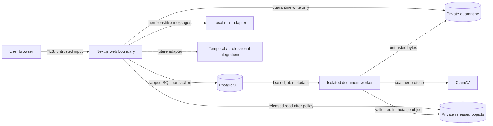

# v0.1 threat model

**Status:** Draft for review; not a validation claim.
**Target:** OWASP ASVS 5.0.0 Level 2 plus risk-based controls.
**Tickets:** RES-004, RES-010 through RES-012, RES-018 through RES-021,
RES-040, RES-041, RES-045

## Assets and trust boundaries

Primary assets are credentials and sessions, intake answers, case membership,
recommendation evidence, documents and metadata, disclosure authorizations,
encryption keys, and audit evidence.

The browser, uploads, email links, filenames, PDF structure, object-store
responses, future integration callbacks, and all user-controlled identifiers are
untrusted. The web process is trusted to authenticate and enforce policy but is
not trusted with scanner administration. The worker treats every quarantined
byte as hostile.

## Principal threats and required mitigations

| Threat                                       | Required design/test response                                                                                                                            |
| -------------------------------------------- | -------------------------------------------------------------------------------------------------------------------------------------------------------- |
| BOLA/IDOR across cases                       | Server-side policy plus case-scoped queries and composite FKs; two-user negative tests for every resource route                                          |
| Membership confused with document permission | Explicit action/purpose document grants; membership-only user is denied                                                                                  |
| Cross-domain disclosure                      | Classification/compartment policy, allowlisted status contracts, consent cannot override a deny rule                                                     |
| Forged or stale consent/grant                | Immutable terms hash, expiry/revocation on every decision, transactional audit history                                                                   |
| Session theft/fixation/CSRF                  | Better Auth server validation, secure host cookies, rotation, revocation, origin/CSRF defenses, bounded lifetimes                                        |
| Credential stuffing/enumeration              | Generic responses and timing, documented rate limits, breached-password check, email verification/recovery tests                                         |
| Malicious/oversized/polyglot PDF             | Stream cap, extension/media/signature/structure checks, quarantine, isolated ClamAV scan, bounded resources, fail closed                                 |
| PDF viewer exploit or active content         | Release only after validation/scan, same-origin authenticated delivery, current PDF.js, scripting disabled, sandboxed viewer/CSP, no third-party fetches |
| Object key guessing or URL leakage           | Random server keys, private buckets, no public ACL, no durable presigned URL, fresh policy decision for retrieval                                        |
| Upload race or overwrite                     | Immutable version keys, content hash, conditional writes, state transition transaction and idempotency tests                                             |
| SSRF through parsers or adapters             | Worker egress deny by default; application outbound allowlist; no user-provided fetch URLs                                                               |
| Sensitive data in logs/errors                | Structured allowlisted audit fields, redaction tests, generic errors, answers and filenames excluded                                                     |
| Audit tampering/insider misuse               | Append-only role, hash chaining/checkpoints, restricted reads, alert on chain failure; external anchoring remains a decision                             |
| Secret or key exposure                       | Externalized secrets, secret scanning, least-privilege service identities, documented key rotation and crypto inventory                                  |
| Resource exhaustion                          | Per-file/request/user limits, streaming, worker CPU/memory/time limits, bounded retries and queue depth                                                  |
| Supply-chain compromise                      | Lockfile, pinned CI actions/images, SBOM/SCA, provenance review, exact version/license inventory                                                         |

## Security decisions required before document code

1. Select and pin the local object store and document its encryption mode. Private
   access alone is not evidence of encryption at rest.
2. Select the PDF structural validator and isolation mechanism. ClamAV alone is
   insufficient to call a preview safe.
3. Define maximum upload size, page/object/expansion limits, scan timeout, retry
   budget, rejection codes, and fail-closed operator recovery.
4. Approve the action/classification/purpose matrix and owner-grant semantics.
5. Approve audit integrity, retention, and privileged audit-reader design.
6. Decide production key management, TLS termination, backup encryption, and
   restore verification. Local defaults are not production controls.

Regulatory applicability remains unassessed under RES-038. This threat model does
not claim GLBA, HIPAA, RESPA, FCRA, bar-rule, court-rule, or state-law compliance.
